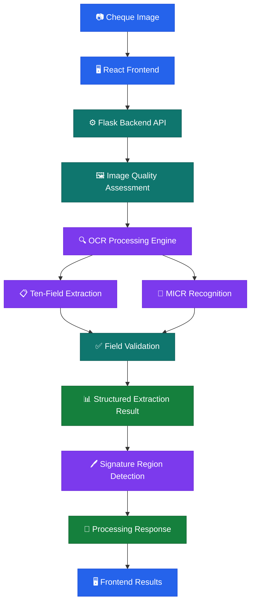
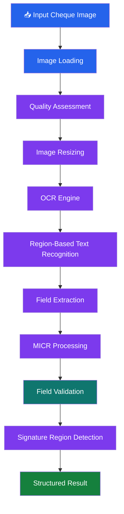
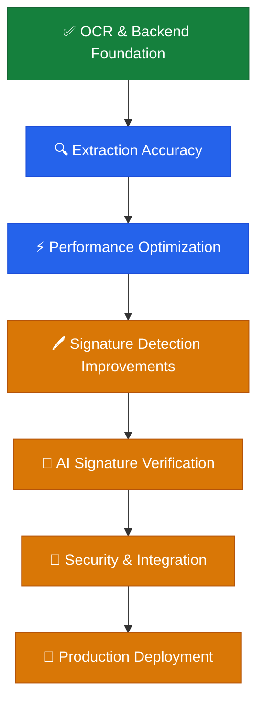

# 🏦 ChequeVerify AI
### Intelligent Cheque Processing, OCR Extraction & Verification Platform

<p align="center">
  
  
  
  
</p>

<p align="center">
  
  
  
  
</p>

<p align="center">
  <b>Automating cheque information extraction, intelligent field validation and signature-region analysis using AI and computer vision.</b>
</p>

---

## 📌 Table of Contents

- [🌟 Project Overview](#-1-project-overview)
- [🎯 Project Objectives](#-2-project-objectives)
- [✨ Key Features](#-3-key-features)
- [🏗️ System Architecture](#-4-system-architecture)
- [🔍 Ten-Field Extraction](#-5-ten-field-cheque-extraction)
- [⚙️ OCR Processing Workflow](#-6-ocr-processing-workflow)
- [🖼️ Image Processing](#-7-image-processing)
- [🧠 MICR Recognition](#-8-micr-recognition)
- [🖊️ Signature Detection](#-9-signature-detection)
- [📊 Dataset Information](#-10-dataset-information)
- [🛠️ Technology Stack](#-11-technology-stack)
- [📁 Project Structure](#-12-project-structure)
- [⚡ Installation](#-13-installation)
- [🚀 Running the Application](#-14-running-the-application)
- [🧪 Testing and Evaluation](#-15-testing-and-evaluation)
- [⏱️ Performance Benchmark](#-16-performance-benchmark)
- [📈 Development Status](#-17-development-status)
- [🗺️ Future Roadmap](#-18-future-roadmap)
- [🔐 Security and Privacy](#-19-security-and-privacy)
- [🎓 Project Applications](#-20-project-applications)
- [🤝 Contribution](#-21-contribution)
- [🏁 Conclusion](#-22-conclusion)

---

## 🌟 1. Project Overview

**ChequeVerify AI** is an intelligent cheque processing and verification platform designed to automate the extraction of banking information from cheque images.

Traditional cheque processing often requires manual reading and data entry. This can be time-consuming and may introduce human errors.

ChequeVerify AI combines Optical Character Recognition (OCR), image processing, MICR recognition, machine learning components and field validation to automate important parts of this workflow.

The system accepts cheque images, processes their contents, extracts structured banking information and returns field-level extraction and validation results.

The platform is designed around two major components:

- **Frontend:** A React-based web application for interacting with cheque processing functionality.
- **Backend:** A Python Flask application responsible for image processing, OCR, MICR recognition, field extraction and validation.

The long-term goal is to extend the platform with authorized signature enrollment, AI-based signature comparison and advanced cheque fraud analysis.

## 🎯 2. Project Objectives

1. Automate cheque information extraction using OCR.
2. Extract ten important cheque fields.
3. Identify bank and branch information.
4. Process MICR information separately from general cheque text.
5. Validate extracted information using field-specific rules.
6. Assess cheque image quality before extraction.
7. Detect and optionally crop possible signature regions.
8. Reduce manual cheque data entry.
9. Improve extraction performance across different bank layouts.
10. Provide structured results for further verification and review.

---

## ✨ 3. Key Features

### 🔍 AI-Based OCR Extraction

- Integrates PaddleOCR for cheque text recognition.
- Processes different cheque regions.
- Extracts banking information into structured fields.
- Supports field-specific extraction and normalization.
- Reuses the initialized OCR engine to avoid unnecessary model initialization.

### 🏦 Banking Information Extraction

- Bank name identification.
- Branch name extraction.
- IFSC code extraction.
- Cheque number recognition.
- Account number extraction.
- MICR information processing.

### 💰 Amount and Date Recognition

- Extracts amount in figures.
- Extracts amount in words.
- Identifies cheque dates.
- Applies field-specific parsing and validation.

### 🖼️ Image Processing

- Image resizing.
- Grayscale conversion.
- Image quality assessment.
- Brightness analysis.
- Contrast analysis.
- Sharpness assessment.
- Image preprocessing for OCR.

### 🧠 MICR Recognition

- Dedicated MICR processing component.
- Separates MICR processing from general OCR.
- Integrates MICR output into the cheque extraction result.

### 🖊️ Signature Region Detection

- Detects possible signature regions.
- Uses image-processing techniques.
- Supports optional signature cropping.
- Stores a detected crop when the configured crop functionality is enabled.

*Signature-region detection is not the same as verifying whether a signature is genuine.*

### ✅ Field Validation

- Validates extracted information.
- Tracks field-level confidence and extraction status.
- Identifies missing or incomplete information.
- Flags records that may require manual review.

### 📊 Testing and Performance Reporting

- Dedicated test dataset.
- OCR testing scripts.
- Bank-wise extraction evaluation.
- Twenty-image extraction benchmark.
- CSV extraction reports.
- JSON performance reports.

---

## 🏗️ 4. System Architecture

ChequeVerify AI uses a frontend-backend architecture.



### Architecture Components

| Component | Responsibility |
|---|---|
| React Frontend | User interaction and results presentation |
| Flask Backend | Application logic and API processing |
| Image Processing | Image preparation and quality assessment |
| PaddleOCR | Text recognition |
| MICR Component | MICR information processing |
| Field Extraction | Extracts ten cheque fields |
| Validation | Checks extracted information |
| Signature Detection | Identifies possible signature region |
| Reporting | Stores benchmark and evaluation reports |

---

## 🔍 5. Ten-Field Cheque Extraction

One of the central features of ChequeVerify AI is extracting ten important fields from cheque images.

| No. | Field | Description |
|---:|---|---|
| 1 | 🏦 Bank Name | Name of the issuing bank |
| 2 | 🏢 Branch Name | Bank branch information |
| 3 | 🔢 IFSC Code | Branch identification code |
| 4 | 🧾 Cheque Number | Unique cheque identification number |
| 5 | 🧲 MICR Code | Magnetic Ink Character Recognition information |
| 6 | 💳 Account Number | Account information |
| 7 | 📅 Date | Cheque issue date |
| 8 | 👤 Payee Name | Name of the cheque recipient |
| 9 | 💰 Amount in Figures | Numeric cheque amount |
| 10 | ✍️ Amount in Words | Written cheque amount |

### Expected Extraction Output

The processing pipeline returns structured information containing extracted fields and associated validation information.

Illustrative response format:

```json
{
  "fields": {
    "bank_name": {},
    "branch_name": {},
    "ifsc_code": {},
    "cheque_number": {},
    "micr_code": {},
    "account_number": {},
    "date": {},
    "payee_name": {},
    "amount_figures": {},
    "amount_words": {}
  },
  "validation": {},
  "micr": {},
  "engine": "PaddleOCR",
  "processing_ms": 0,
  "needs_review": false
}
```

*This is a structural illustration, not a guaranteed literal API response for every configuration.*

---

## ⚙️ 6. OCR Processing Workflow

The extraction pipeline follows these stages:



### Processing Stages

1. Receive the cheque image.
2. Load the image using OpenCV.
3. Assess image quality.
4. Resize the image to the configured working dimensions.
5. Initialize or reuse the OCR engine.
6. Recognize text from relevant cheque regions.
7. Extract the ten cheque fields.
8. Process MICR information.
9. Validate the extracted values.
10. Detect the possible signature region.
11. Return structured processing results.

### OCR Engine Optimization

The OCR engine uses initialization caching.

This avoids repeatedly loading the OCR model for every cheque. However, model caching does not eliminate the time spent on OCR inference itself.

Further inference optimization is part of the performance improvement work.

---

## 🖼️ 7. Image Processing

OpenCV is used for cheque image preparation and quality analysis.

### Image Quality Assessment

The quality assessment component evaluates:

- Image sharpness.
- Brightness.
- Contrast.
- Image dimensions.
- Aspect ratio.

### Image Preprocessing

The processing pipeline uses operations such as:

- Image resizing.
- Grayscale conversion.
- Region cropping.
- Image normalization where required.

These operations help prepare cheque images for subsequent OCR processing.

---

## 🧠 8. MICR Recognition

MICR stands for **Magnetic Ink Character Recognition**.

MICR information is important for cheque identification and banking operations.

ChequeVerify AI includes a dedicated MICR processing component that:

1. Processes the cheque image.
2. Extracts MICR-related information.
3. Integrates the MICR result into the extraction output.
4. Makes the information available for validation and further processing.

MICR recognition is handled separately from general OCR field extraction.

---

## 🖊️ 9. Signature Detection

The current system includes signature-region detection.

The signature detection component uses image-processing techniques such as:

- Region-based image processing.
- Median filtering.
- Image normalization.
- Thresholding.
- Morphological operations.
- Connected-component analysis.

### Current Capability

- Identify a possible signature region.
- Return signature detection information.
- Optionally crop and save the detected region.

### Planned Signature Verification

The next development stage can introduce:

- Authorized signature enrollment.
- Specimen signature storage.
- Signature image preprocessing.
- Siamese Neural Network or embedding-based comparison.
- Similarity threshold calibration.
- Genuine and forged signature evaluation.
- Manual review for uncertain results.

**Important:** Signature-region detection is currently different from AI-based signature authenticity verification. A similarity score should never be treated as definitive proof of authenticity.

---

## 📊 10. Dataset Information

The project contains cheque images organized into training, validation and testing splits.

### Dataset Organization

```text
dataset/
│
└── new_datset/
    └── new_datset/
        ├── train/
        ├── val/
        └── test/
```

### Current Test Dataset

The dedicated test split contains 20 cheque images.

| Bank Category | Test Images |
|---|---:|
| Axis Bank | 5 |
| Canara Bank | 5 |
| ICICI Bank | 5 |
| Syndicate Bank | 5 |
| **Total** | **20** |

### Dataset Purpose

- Evaluate cheque text extraction.
- Test different cheque layouts.
- Examine bank-specific extraction behavior.
- Identify missing fields.
- Measure processing time.
- Evaluate extraction accuracy using manually verified values.

The test split should remain separate from training and validation data during final evaluation.

---

## 🛠️ 11. Technology Stack

<p align="center">
  
  
  
  
</p>

<p align="center">
  
  
  
  
  
</p>

| Layer | Technology |
|---|---|
| Frontend | React |
| Frontend Build Tool | Vite |
| Backend | Python |
| Backend Framework | Flask |
| OCR Engine | PaddleOCR |
| Image Processing | OpenCV |
| Numerical Processing | NumPy |
| Machine Learning | Scikit-learn |
| MICR | Dedicated MICR component |
| Version Control | Git and GitHub |

---

## 📁 12. Project Structure

The following is a logical overview of the main project components.

```text
ChequeVerify/
│
├── backend/
│   │
│   ├── app/
│   │   ├── ocr/
│   │   │   ├── engine.py
│   │   │   └── fields.py
│   │   │
│   │   ├── services/
│   │   │   ├── cheques.py
│   │   │   └── models.py
│   │   │
│   │   ├── signature/
│   │   │   └── detect.py
│   │   │
│   │   └── ...
│   │
│   ├── requirements.txt
│   └── ...
│
├── frontend/
│   │
│   ├── src/
│   ├── public/
│   ├── package.json
│   └── ...
│
├── dataset/
│   │
│   └── new_datset/
│       └── new_datset/
│           ├── train/
│           ├── val/
│           └── test/
│
├── reports/
│   │
│   ├── paddleocr_test/
│   │   └── run_batch_ocr.py
│   │
│   └── FINAL_TESTING/
│       ├── benchmark_20_extraction.py
│       └── ...
│
├── .venv/
├── README.md
└── ...
```

*The structure is a project overview. Refer to the actual working directory for the complete list of files.*

---

## ⚡ 13. Installation

### Prerequisites

- Python 3.12 or a compatible Python version.
- Node.js.
- npm.
- Git.
- Required Python packages.
- Required OCR model files.

### Step 1 — Clone the Repository

```powershell
git clone <YOUR_GITHUB_REPOSITORY_URL>
cd ChequeVerify
```

### Step 2 — Setup Backend Environment

From the project root:

```powershell
python -m venv .venv

.\.venv\Scripts\Activate.ps1

python -m pip install --upgrade pip
```

Install backend dependencies:

```powershell
pip install -r .\backend\requirements.txt
```

### Step 3 — Setup Frontend

```powershell
cd frontend

npm install
```

---

## 🚀 14. Running the Application

### 🟢 Terminal 1 — Backend

Open PowerShell:

```powershell
cd N:\ChequeVerify-AI\ChequeVerify

.\.venv\Scripts\Activate.ps1

cd backend

python -m flask --app app run --debug
```

If the project uses a different Flask entry point, use the configured entry point from the backend source.

### 🔵 Terminal 2 — Frontend

Open a second PowerShell terminal:

```powershell
cd N:\ChequeVerify-AI\ChequeVerify\frontend

npm run dev
```

Open the local URL displayed by Vite in your browser.

---

## 🧪 15. Testing and Evaluation

Testing is important for determining whether the extracted cheque values are correct.

### Testing Areas

| Test | Purpose |
|---|---|
| Image Loading | Confirm cheque images load successfully |
| OCR Testing | Verify text recognition |
| Ten-Field Testing | Check all ten extraction fields |
| MICR Testing | Evaluate MICR output |
| Field Validation | Identify missing or invalid values |
| Signature Detection | Check possible signature-region detection |
| Bank-wise Testing | Evaluate different cheque layouts |
| Performance Testing | Measure processing time |
| Frontend Testing | Verify user interface behavior |
| API Testing | Validate backend responses |

### Accuracy Evaluation

A populated field is not necessarily a correct field.

Final extraction accuracy should be evaluated using manually verified ground-truth values.

Recommended metrics:

- Field-wise accuracy.
- Precision.
- Recall.
- F1-score.
- Missing-field percentage.
- Bank-wise accuracy.
- Average processing time.

---

## ⏱️ 16. Performance Benchmark

A dedicated benchmark is included to measure complete cheque extraction performance.

### Benchmark Script

```text
reports/FINAL_TESTING/benchmark_20_extraction.py
```

### Run Benchmark

From the project root:

```powershell
cd N:\ChequeVerify-AI\ChequeVerify

& .\.venv\Scripts\python.exe .\reports\FINAL_TESTING\benchmark_20_extraction.py
```

### Performance Objective

<details>
<summary><b>📊 Expand performance targets</b></summary>

| Metric | Target |
|---|---:|
| Test images | 20 |
| Fields per image | 10 |
| Total field outputs | 200 |
| Total processing time | ≤ 30 seconds |
| Average time per image | ≤ 1.5 seconds |

</details>

### Benchmark Reports

The benchmark is designed to generate:

- CSV extraction report.
- JSON performance report.
- Per-image extraction time.
- Field extraction status.
- Processing engine information.
- Batch processing time.
- Target achievement status.

**Performance target is not the same as measured performance.** The final result must be confirmed using the generated benchmark report.

---

## 📈 17. Development Status

The project has progressed through frontend development, backend integration, OCR implementation, field extraction and testing preparation.

### Implemented or Integrated

- [x] React frontend foundation.
- [x] Flask backend application.
- [x] PaddleOCR integration.
- [x] OCR engine initialization caching.
- [x] Ten-field extraction pipeline.
- [x] MICR processing integration.
- [x] Image quality assessment.
- [x] Field validation and review status.
- [x] Signature-region detection.
- [x] Optional signature cropping.
- [x] Dataset organization.
- [x] OCR testing script.
- [x] Dedicated 20-image extraction benchmark.
- [x] CSV and JSON performance reporting.

### Remaining Verification and Improvements

- [ ] Confirm field accuracy for all 20 test images.
- [ ] Complete ground-truth comparison.
- [ ] Measure actual 20-image extraction time.
- [ ] Optimize repeated OCR inference.
- [ ] Confirm the 30-second performance target.
- [ ] Complete final frontend-backend integration testing.
- [ ] Improve bank-specific extraction reliability.

### Planned Advanced Features

- [ ] Authorized signature enrollment.
- [ ] Specimen signature management.
- [ ] AI-based signature similarity verification.
- [ ] Cheque tampering detection.
- [ ] Duplicate cheque detection.
- [ ] Advanced fraud analysis.
- [ ] Production deployment.

---

## 🗺️ 18. Future Roadmap

The future development roadmap is divided into six major stages.



### Phase 1 — OCR Reliability

- Improve field extraction.
- Resolve bank-specific recognition errors.
- Improve MICR and cheque-number recognition.
- Validate extracted values against ground truth.

### Phase 2 — Performance Optimization

- Reduce repeated OCR inference.
- Optimize image preprocessing.
- Evaluate model inference strategies.
- Improve batch processing speed.

### Phase 3 — Signature Processing

- Improve signature-region detection.
- Improve crop quality.
- Handle faint and rotated signatures.
- Build a dedicated signature dataset.

### Phase 4 — Signature Verification

- Enroll authorized specimen signatures.
- Develop signature embeddings.
- Train and evaluate a Siamese Network or suitable comparison model.
- Calibrate similarity thresholds.
- Add manual review for uncertain results.

### Phase 5 — Full Integration

- Integrate extraction and signature verification.
- Improve frontend result presentation.
- Add verification history.
- Generate downloadable reports.

### Phase 6 — Production Readiness

- Improve authentication and access control.
- Secure cheque images and sensitive information.
- Implement data retention policies.
- Complete end-to-end testing.
- Deploy the complete application.

---

## 🔐 19. Security and Privacy

Cheque images contain sensitive banking information.

The system should follow these security practices:

- Do not publish real cheque images containing private information.
- Do not commit passwords, API keys or secret configuration files.
- Restrict access to cheque records.
- Protect account numbers and personal information in logs.
- Secure stored cheque images and signature specimens.
- Use encrypted communication in production.
- Apply suitable data retention and deletion policies.
- Maintain audit logs for sensitive operations.

---

## 🎓 20. Project Applications

ChequeVerify AI can be extended for applications such as:

- Banking cheque processing.
- Financial document digitization.
- Automated banking data entry.
- Cheque information extraction.
- Document validation workflows.
- Signature-based verification systems.
- Financial document analysis.
- Banking workflow automation.

The system is a development project and should not be treated as a production banking verification service without appropriate security, accuracy, regulatory and operational validation.

---

## 🤝 21. Contribution

Contributions and suggestions are welcome.

To contribute:

1. Fork the repository.
2. Create a new feature branch.
3. Implement your changes.
4. Test the changes.
5. Submit a pull request with a clear description.

---

## 🏁 22. Conclusion

**ChequeVerify AI** combines OCR, computer vision, MICR recognition and structured field validation to automate important parts of cheque processing.

The system targets ten important cheque fields and includes image-quality assessment, signature-region detection and performance evaluation capabilities.

The next major development priorities are improving extraction accuracy, optimizing batch processing performance and extending the platform with AI-based signature verification.

<p align="center">
  
  
  
</p>

<p align="center">
  <b>🏦 ChequeVerify AI</b>
  <br/>
  <i>From cheque image processing to intelligent verification.</i>
  <br/><br/>
  Built with Python, React, PaddleOCR and OpenCV.
</p>
