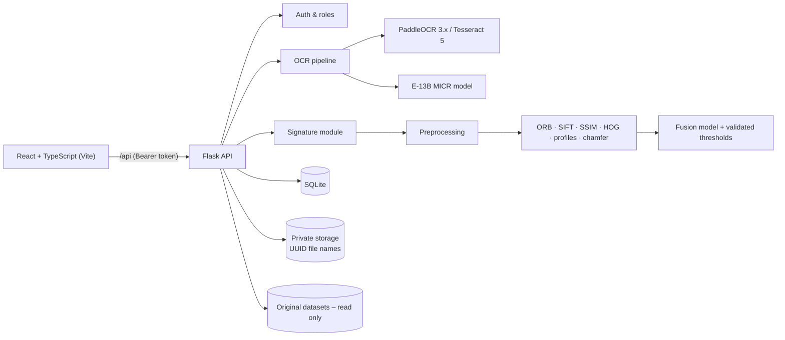

# ChequeVerify AI

Cheque OCR, field validation and signature verification for Indian CTS-2010 cheques –
a Flask + React (TypeScript) web application with role-based access, full CRUD,
audit logging, dataset auditing, model training/evaluation and PDF/CSV reporting.

> **Decision support, not a guarantee.** Every OCR value carries a confidence and a
> review status, and every signature result is MATCH / REVIEW / MISMATCH with its
> reasons. An authorised person makes the final call.

---

## 1. Problem and objectives

Banks still key in cheque details by hand and compare signatures by eye. This project:

1. Extracts the ten cheque fields from an image and validates them (IFSC format, bank/IFSC
   consistency, amount-in-words vs figures, date validity, MICR/cheque-number format).
2. Lets an administrator enroll authorised signers with one or more specimen signatures.
3. Compares the signature on a cheque with the enrolled specimens and returns an
   explained MATCH / REVIEW / MISMATCH decision for manual confirmation.
4. Keeps a complete, exportable record (history, audit trail, PDF and CSV reports).
5. Is honest about what the available data can and cannot support.

## 2. Features

| Area | What works |
|---|---|
| Cheque OCR | Upload → quality check → OCR (PaddleOCR 3.x if installed, else Tesseract 5) → 10 fields with confidence/source/status → validation checks → automatic signature crop |
| MICR | Dedicated E-13B reader (template model learned from the train split) for cheque number + MICR code |
| Review | Edit any field; machine values are preserved and edits stored as corrections; reviewer notes; mark reviewed |
| Batch | Up to 20 cheques per batch |
| Enrollment | Signer CRUD, multiple specimens, quality gate, preprocessing preview, duplicate detection (same signer and across signers), replace/deactivate/delete, enrollment history, dataset import |
| Verification | From a processed cheque (auto or manual crop) or an uploaded image; compares against all active specimens; reasons, feature scores, threshold scale; manual approve/reject |
| Datasets | Live audits of both datasets; manifest-based browser |
| Models | Readiness assessment; background training/evaluation jobs with history and metrics |
| Reports | Per-cheque PDF; CSV exports (cheques, verifications, signers, audit log); audit/evaluation report downloads |
| Security | Token auth, 3 roles, lockout, token revocation, upload validation by content, private storage, audited biometric access, masked account numbers |

### Screens
Dashboard · Cheque verification · Cheque detail · Signature verification · Signature enrollment ·
Signer detail · Batch processing · OCR dataset · Signature dataset · Model training · Analytics ·
Verification history · Reports · Settings (thresholds, users, password, audit log).

## 3. Architecture



Cheque workflow: upload → validate file (magic bytes, size, decode) → image quality → OCR + MICR →
10 fields → validation → signature detection/crop → (account number suggests an enrolled signer) →
operator review → signature comparison (only if the signer has an active specimen) → manual
approve/reject → PDF report → every step written to the audit log.

## 4. Technology

Backend: Python 3.12+, Flask 3, OpenCV, NumPy, ReportLab, SQLite (stdlib), Waitress (production).
OCR: PaddleOCR 3.x (auto-detected) or the Tesseract 5 binary. Frontend: React 18, TypeScript 5,
Vite 5 – no UI library; icons are inline SVG. Tests: pytest, Playwright (end-to-end, run during development).

## 5. Folder structure

```text
ChequeVerify/
├── backend/
│   ├── app/
│   │   ├── __init__.py          app factory, error handling, security headers, serves frontend/dist
│   │   ├── config.py            all settings (env vars / backend/.env)
│   │   ├── db.py                SQLite schema + helpers
│   │   ├── api/                 auth_routes, cheque_routes, signer_routes, verification_routes, system_routes
│   │   ├── ocr/                 engine.py, fields.py, regions.py, micr.py, amounts.py, quality.py, evaluate.py
│   │   ├── signature/           preprocess.py, compare.py, detect.py, training.py
│   │   └── services/            auth, audit, storage, cheques, enrollment, datasets, jobs, models, reports
│   ├── models_store/            micr_e13b.npz, signature_fusion.json (trained artefacts)
│   ├── tests/                   pytest suite (54 tests)
│   ├── manage.py                CLI: audit, train-micr, train-signature, eval-ocr, create-user, reset-password
│   ├── run.py / wsgi.py         dev + production entry points
│   ├── requirements.txt
│   └── .env.example
├── frontend/
│   ├── src/                     main.tsx, App.tsx, api.ts, auth.tsx, router.ts, styles.css, components/, pages/
│   ├── dist/                    prebuilt production bundle (rebuilt by `npm run build`)
│   ├── package.json, vite.config.ts, tsconfig.json, index.html
├── docs/                        API.md, ARCHITECTURE.md, OCR_DATASET.md, SIGNATURE_DATASET.md, SECURITY.md
├── reports/final/               audits, evaluations, test results, completion report
├── dataset/                     ← put the OCR dataset here (train/ vaildate/ test/ <bank>/)
├── signature/                   ← put the signature dataset here (genuine_signatures.csv …)
├── start.ps1 / start.sh         one-command setup, run, dev mode and tests
└── README.md
```

## 6. Datasets

**OCR dataset (`dataset/`)** – 120 cheque images, 4 banks (Axis, Canara, ICICI, Syndicate),
split 80/20/20 (5 per bank in val and test), no corrupted files, no exact duplicates or cross-split
filename leakage. **There are no transcription labels**, and the filled-in fields are machine-printed,
not handwritten (only the signature is handwritten). The only labels are weak: bank and split from
folders, and the cheque number = filename stem (119/120 files). See `docs/OCR_DATASET.md`.

**Signature dataset (`signature/`)** – 120 genuine specimens (one per signer, 120 signers),
240 synthetic alterations (2 per signer: random added/erased strokes), manifests valid, no missing or
corrupted files, no signer in more than one split. One specimen per signer means signer-specific or
Siamese training is **blocked**. See `docs/SIGNATURE_DATASET.md`.

## 7. Models and results (held-out test split, measured – not estimated)

| Component | What was trained | Test result |
|---|---|---|
| MICR E-13B reader | 480 glyph templates from 80 train cheques (labels = filename cheque number) | Cheque number exact match **20 of 20** test cheques (19/19 val). 95 % lower confidence bound ≈ 83 %. |
| Field extraction (Tesseract 5.3.4) | Rules + region isolation; developed on train/val, test run once | Account number found in signature registry 18/20 · amount words = figures 17/20 · valid date 19/20 · all 10 fields filled except branch 85 %, account 90 %, date 95 % |
| Handwritten OCR | — | **Blocked**: no handwritten fields, no transcriptions |
| Signature fusion (logistic regression over 8 similarity features) | Train pairs only; thresholds on validation | ROC-AUC 0.864, EER 0.232. Different-signer pairs: AUC 0.998, 0/60 accepted. Synthetic alterations: AUC 0.66 – weak. At the validated match threshold: FAR 1 %, FRR 78 % (most genuine pairs go to REVIEW, by design) |
| Signer-specific / Siamese | — | **Blocked**: needs several real specimens per signer |

Full numbers, protocol and caveats: `reports/final/MODEL_EVALUATION.md`.
Positive signature pairs are *simulated re-captures* of the single genuine image, because the dataset
has no second genuine specimen – this is the main limitation of the signature results.

## 8. Installation (Windows – your existing machine)

Prerequisites: Python 3.12 (your `.venv312` works), Node.js 18+, and an OCR engine:
either your existing PaddleOCR 3.x environment (auto-detected) or
[Tesseract for Windows](https://github.com/UB-Mannheim/tesseract/wiki).

```powershell
cd N:\Cheque\ChequeVerify          # wherever you unzipped the project
# 1. datasets (copied or pointed to – originals are never modified)
#    either copy them to .\dataset and .\signature, or set paths in backend\.env
copy backend\.env.example backend\.env
notepad backend\.env               # e.g. CV_OCR_DATASET=N:\Cheque\ChequeA\dataset
                                   #      CV_SIGNATURE_DATASET=N:\Cheque\ChequeA\signature
# 2. install
.\start.ps1 -Setup
# 3. test
.\start.ps1 -Test
# 4. run (production build, one process, http://127.0.0.1:5000)
.\start.ps1
# or development mode with hot reload (Flask :5000 + Vite :5173)
.\start.ps1 -Dev
```

If PowerShell blocks the script: `Set-ExecutionPolicy -Scope Process Bypass`.

Manual equivalent:

```powershell
python -m venv .venv ; .\.venv\Scripts\Activate.ps1
pip install -r backend\requirements.txt
cd frontend ; npm install ; npm run build ; cd ..
cd backend ; python -m pytest -q ; python run.py --prod
```

Linux/macOS: `./start.sh setup`, `./start.sh test`, `./start.sh`, `./start.sh dev`
(`sudo apt install tesseract-ocr` for the OCR engine).

**First sign-in.** On first start the backend creates user `admin` and prints a random password in
the terminal (or uses `CV_ADMIN_PASSWORD` from `.env`). Change it under Settings → Your password, then
create operator/auditor accounts under Settings → Users.

Suggested first steps in the app: Signature enrollment → *Import from dataset* (creates the 120 signers),
then Cheque verification → upload a cheque from `dataset/test/...` → Verify signature.

## 9. Configuration (`backend/.env`)

| Variable | Default | Meaning |
|---|---|---|
| `CV_OCR_DATASET`, `CV_SIGNATURE_DATASET` | `dataset`, `signature` | Dataset locations (absolute or relative to project root) |
| `CV_OCR_ENGINE` | `auto` | `auto`, `paddle`, `tesseract`, `none` |
| `CV_TESSERACT_CMD` | PATH / `C:\Program Files\Tesseract-OCR\tesseract.exe` | Tesseract binary |
| `CV_SECRET_KEY` | random, stored in `backend/instance/secret_key` | Token signing key |
| `CV_ADMIN_PASSWORD` | random, printed once | First admin password |
| `CV_MAX_UPLOAD_MB` | 10 | Upload limit |
| `CV_CORS_ORIGINS` | localhost:5173 | Only needed when the UI is served from another origin |
| `CV_TOKEN_MAX_AGE` | 28800 | Session lifetime (seconds) |
| `CV_INSTANCE_DIR`, `CV_STORAGE_DIR`, `CV_DATABASE`, `CV_MODELS_DIR`, `CV_REPORTS_DIR` | under backend/ | Storage locations |

## 10. Command-line tasks

```bash
cd backend
python manage.py audit                    # both dataset audits -> reports/final/*_AUDIT.json
python manage.py train-micr               # MICR templates (train) + val/test evaluation
python manage.py train-signature          # fusion (train) + thresholds (val) + test evaluation
python manage.py eval-ocr --split test    # field-extraction evaluation
python manage.py create-user alice --role operator
python manage.py reset-password admin
python -m pytest -q                       # 54 backend tests
```
The same jobs can be started from the Model training screen (admin).

## 11. Security

Summary (details in `docs/SECURITY.md` and `reports/final/SECURITY_AUDIT.md`): signed bearer tokens
with server-side revocation, three roles enforced on every endpoint, enrollment admin-only, specimen
images never public (admin/operator only, each view audited), uploads validated by content and stored
under random names, path-traversal protection on every file endpoint, no stack traces or paths in
errors, CSV formula-injection protection, account numbers masked in lists/exports/PDF, login lockout,
strict CORS allow-list, security headers. **Not production-banking ready** without HTTPS, an external
identity provider/MFA, encrypted storage, retention policies and an independent security test.

## 12. Limitations

- The OCR dataset has no text labels: field accuracy can only be measured for the cheque number;
  other fields are checked by self-consistency and cross-reference, not ground truth. Staff
  corrections made in the app are the start of a real labelled set.
- Fields on these cheques are typed; real handwritten cheques will perform worse with Tesseract.
- Test cheques share templates with training cheques, so results on unseen layouts will be lower.
- Signature verification: one specimen per signer, synthetic alterations only, simulated positive pairs,
  20 test signers. Detection of small stroke alterations is weak (AUC ≈ 0.66).
- In this dataset the enrolled specimens were cropped from the same cheque scans, so verifying those
  cheques against them is not an independent test (it will usually say MATCH).
- PaddleOCR adapter follows the documented 3.x API but was not executed in the build environment.

## 13. Future scope

Collect ≥ 5 genuine specimens per signer and real skilled forgeries, then train a metric-learning model;
label handwritten field crops (the review screen already records corrections) and fine-tune PaddleOCR
recognition; layout detection for unseen templates; MFA/SSO; encrypted object storage; PostgreSQL.

## 14. Troubleshooting

| Symptom | Fix |
|---|---|
| "No OCR engine available" | Install Tesseract or activate the PaddleOCR environment; set `CV_TESSERACT_CMD` |
| Fields all "missing" except cheque number | Same as above – MICR works without an OCR engine |
| Dataset screens say "not found" | Set `CV_OCR_DATASET` / `CV_SIGNATURE_DATASET` in `backend/.env` |
| Forgot admin password | `python manage.py reset-password admin` |
| Account locked | Wait 5 minutes or reset the password |
| `npm run build` type errors | `cd frontend && npm install` (types come from `@types/react`) |
| Port 5000 busy | `.\start.ps1 -Port 8000` |

## 15. Status

See `reports/final/FINAL_PROJECT_COMPLETION_REPORT.md` for what was built, tested and what remains.
